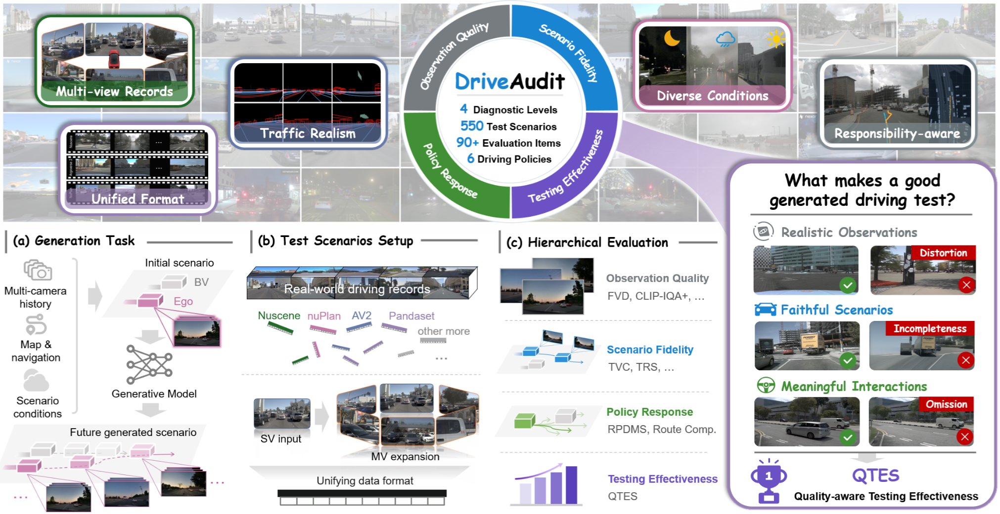

[](README.md) [](README.zh-CN.md)

<div align="center" id="top">


## Beyond Visual Realism: Benchmarking Generated Driving Scenarios as Policy Tests

**Does a generated driving scenario merely look realistic—or work as a credible policy test?**

[](#dataset)
[](#benchmarked-models)
[](#benchmarked-models)
[](#closed-loop)
[](#leaderboard)

[Overview](#overview) · [Evaluation](#evaluation) · [Leaderboard](#leaderboard) · [Getting Started](#getting-started) · [Documentation](#documentation)



</div>

<a id="overview"></a>
## 🔎 Overview

Photorealistic driving videos are not necessarily reliable policy tests: generated images may disagree with traffic states, and corrupted observations can cause failures without exposing a meaningful driving weakness. **DriveAudit evaluates the testing value of generated driving scenarios, not visual realism or policy failure in isolation.**

The pipeline separates **traffic trajectory generation** from **multi-view rendering**, then evaluates an independent driving policy on generated and recorded observations. Comparing recorded-traffic rendering with generated-traffic rendering helps isolate the effect of alternative traffic futures.

### Highlights

- **Four-level evaluation:** connect observation quality, scenario fidelity, policy response, and testing effectiveness in one framework.
- **Quality-aware scoring:** QTES rewards paired policy degradation together with retained scenario quality; RPDMS adds responsibility-aware collision scoring.
- **Multi-source, multi-model benchmark:** 550 scenarios, seven generation baselines, and six driving policies, with tooling for traffic generation, rendering, paired evaluation, and closed-loop feedback.

### Contents

- [Evaluation framework](#evaluation)
- [Dataset](#dataset)
- [Leaderboard and benchmarked models](#leaderboard)
- [Getting started](#getting-started)
- [Closed-loop testing](#closed-loop)
- [Documentation](#documentation)

<a id="evaluation"></a>
## 📐 Evaluation Framework

<table>
<thead><tr><th></th><th>Dimension</th><th>Description</th></tr></thead>
<tbody>
<tr>
<td width="144" align="center"></td>
<td width="170"><b>Observation quality</b></td>
<td><p><b>FVD ↓ · CLIP-IQA+ ↑ · DINO-T ↑</b></p><p>FVD and CLIP-IQA+ assess visual realism and perceptual quality, while DINO-T measures temporal coherence. Together they check whether generated observations are credible and stable, before interpreting policy behavior.</p></td>
</tr>
<tr>
<td width="144" align="center"></td>
<td width="170"><b>Scenario fidelity</b></td>
<td><p><b>Epi@3 ↑ · TVC ↑ · TRS ↑</b></p><p>Epi@3 measures cross-view geometric consistency, and TVC checks agreement between rendered images and traffic states. TRS assesses the traffic distribution with an additional geometric-overlap penalty; plausible alternative futures need not reproduce the recorded future.</p></td>
</tr>
<tr>
<td width="144" align="center"></td>
<td width="170"><b>Policy response</b></td>
<td><p><b>RPDMS ↑ · Route Completion ↑</b></p><p>An independent, frozen driving policy is evaluated for safety, comfort, progress, and route completion. RPDMS corrects collision scoring for ego responsibility, while Route Completion measures how much of the route the policy completes.</p></td>
</tr>
<tr>
<td width="144" align="center"></td>
<td width="170"><b>Quality-aware testing effectiveness</b></td>
<td><p><b>QTES ↑</b></p><p>QTES multiplicatively constrains paired policy degradation by retained observation quality and scenario fidelity. A valid reference self-comparison scores 50: more policy failures alone do not imply a better test, especially when quality deteriorates.</p></td>
</tr>
</tbody>
</table>

The same frozen policy runs on both branches with matched scene identities, timestamps, calibration, and public ego motion. Each branch uses its own traffic for scoring. **Higher RPDMS means better policy performance; higher QTES means greater quality-aware testing effectiveness.**

The main benchmark uses **non-reactive replay**: predicted actions do not change subsequent observations. The separate [closed-loop runner](#closed-loop) feeds executed actions back into generation. See the [evaluation guide](docs/evaluation.md) for quality evidence, common-support requirements, and the distinction between single-policy diagnostics and formal six-policy QTES.

<a id="dataset"></a>
## 📦 Dataset

The manuscript benchmark contains **550 scenario histories from five sources**, using a six-view interface with timestamps, calibration, and traffic states.

| Input group | Sources | Scenarios | Views |
| --- | --- | ---: | --- |
| Native multi-camera | nuScenes, Argoverse 2, nuPlan, PandaSet | 500 | Recorded multi-camera histories |
| Monocular-derived multi-view | Nexar | 50 | Recorded front view; five views completed generatively |

The runnable example selects **two nuScenes scenes**, `case_000001` and `case_000002`, and generates **80 future frames × 6 cameras** per scene. Histories use frames 0–9; generation targets frames 10–89, conditioned on the public ego and camera poses. Observed and synthesized views remain distinguished.

Participant archives, model weights, and organizer reference assets are provisioned separately. See [input preparation and submission](docs/generation.md#participant-inputs-and-submission) for the available package format and export steps.

<a id="benchmark-results"></a>
<a id="leaderboard"></a>
## ⚖️ Leaderboard

<p align="center">
<a href="https://nova-chen151.github.io/Onsite3DSG-Benchmark.github.io/"></a>
</p>

Visit the leaderboard website using the button above. This README introduces the evaluation dimensions and benchmarked models without duplicating numerical results.

<a id="model-zoo"></a>
<a id="benchmarked-models"></a>
<details open>
<summary><b>Benchmarked Models</b></summary>

### Six-view rendering models · source

- [x] [MagicDrive-V2](models/generation/image/MagicDrive-V2)
- [x] [OpenDWM](models/generation/image/OpenDWM)
- [x] [Panacea](models/generation/image/Panacea)
- [x] [DreamForge](models/generation/image/DreamForge)
- [x] [BaseDreamer](models/generation/image/BaseDreamer)
- [x] [HorizonDrive](models/generation/image/HorizonDrive)
- [x] [MagicDrive](models/generation/image/MagicDrive)

### Driving policies · source

- [x] [UniAD](models/agents/UniAD)
- [x] [VAD](models/agents/VAD)
- [x] [DrivoR](models/agents/DrivoR)
- [x] [SparseDriveV2](models/agents/SparseDriveV2)
- [x] [DiffusionDriveV2](models/agents/DiffusionDriveV2)
- [x] [GoalFlow](models/agents/GoalFlow)

**Traffic-generation backend:** [CAT-K](models/generation/trajectory/CAT-K) supplies traffic trajectories and is not one of the seven main rendering baselines. See the [generation guide](docs/generation.md) for renderer setup and the [evaluation guide](docs/evaluation.md) for policy adapters and the sensor protocol.

Native model sources are included. Checkpoints and compatible per-model Python/CUDA environments must be prepared separately; the orchestration package does not replace upstream runtime dependencies.

</details>

<a id="getting-started"></a>
## 🎯 Getting Started

### 1. Clone and install

```bash
git clone https://github.com/Nova-chen151/DriveAudit.git
cd DriveAudit
python -m pip install -e '.[evaluation]'
python -m driveaudit --help
```

The orchestration package requires **Python ≥ 3.9**. Native GPU inference requires Linux and each model's compatible environment. Follow the [generation guide](docs/generation.md) to install source adapters, compiled extensions, and external weights; use the [policy guide](docs/evaluation.md) for driving-policy environments.

### 2. Prepare resources and configuration

Prepare the participant archive, native runtimes, and checkpoints. For paired evaluation, also provide the organizer scene mapping and recorded reference assets. Keep local resources under ignored `work/` and `weights/`, or point configuration paths to external storage.

| Configuration | Purpose |
| --- | --- |
| [generation.json](configs/generation.json) | Participant archive, scenes, CAT-K, renderers, and interpreters |
| [pipeline.json](configs/pipeline.json) | Generation, policy selection, organizer resources, and outputs |
| [quality.yaml](configs/quality.yaml) | Visual-quality evaluation settings |

JSON paths resolve **relative to the configuration file**. The example selects **OpenDWM + DrivoR**. Adjust Slurm partitions, GPU types, and resource paths for your cluster; use a distinct evaluation output directory for each renderer.

### 3. Inspect and submit the pipeline

```bash
# Inspect stage commands before submitting GPU work.
python -m driveaudit run --config configs/pipeline.json --plan

# Submit traffic generation, rendering, and configured evaluation stages.
bash scripts/submit_demo.sh configs/pipeline.json
```

The generation flow is **CAT-K traffic → renderer conditions → six-view RGB**. Participants can stop after rendering and [export a submission](docs/generation.md#participant-inputs-and-submission). Recorded-reference staging and paired scoring require organizer assets.

### 4. Evaluate the six-policy panel

After generated observations, paired reference inputs, policy assets, and quality measurements are ready:

```bash
bash scripts/submit_panel.sh configs/pipeline.json

# Inspect one policy invocation.
python -m driveaudit panel infer --config configs/pipeline.json \
  --policy goalflow --source generated --plan
```

The panel evaluates each policy on generated and recorded branches. Reports contain paired policy scores, TE, QTES, quality retention, and coverage. See [policies and evaluation](docs/evaluation.md) for standalone inference, scoring, and required evidence.

<a id="closed-loop"></a>
## 🔁 Closed-loop Testing

The closed-loop runner connects **CAT-K → six-view rendering → DrivoR → ego execution → updated traffic history**. Each round executes the first 0.5 s of the predicted plan in five 0.1 s substeps, then regenerates observations from the updated state.

Use the [closed-loop guide](closed_loop/README.md) to configure a scene, select a renderer, run GPU inference, and verify the feedback chain. This verification checks execution and observation consistency, rather than reproducing the full benchmark score.

<a id="documentation"></a>
## 📚 Documentation

| Task | Guide |
| --- | --- |
| Prepare inputs and weights; generate traffic and RGB; export submissions | [Generation](docs/generation.md) |
| Configure policies; run paired inference and QTES evaluation | [Policies and evaluation](docs/evaluation.md) |
| Run and verify action-feedback testing | [Closed-loop testing](closed_loop/README.md) |

## 🤝 Acknowledgements and Terms

DriveAudit builds on [NAVSIM](https://github.com/autonomousvision/navsim) and the traffic-generation, rendering, and driving-policy projects listed in the [benchmarked models](#benchmarked-models).

The overview figure comes from the supplied manuscript *Beyond Visual Realism: Benchmarking Generated Driving Scenarios as Policy Tests*. The animated evaluation icons and custom wordmark are original, rendered with [render_framework.py](assets/readme/render_framework.py) and [render_title.py](assets/readme/render_title.py). The paper figure retains its original rights.

Upstream code retains its original licenses and notices. Datasets, pretrained weights, and derived data remain subject to their respective usage and redistribution terms.

[↑ Back to top](#top)
