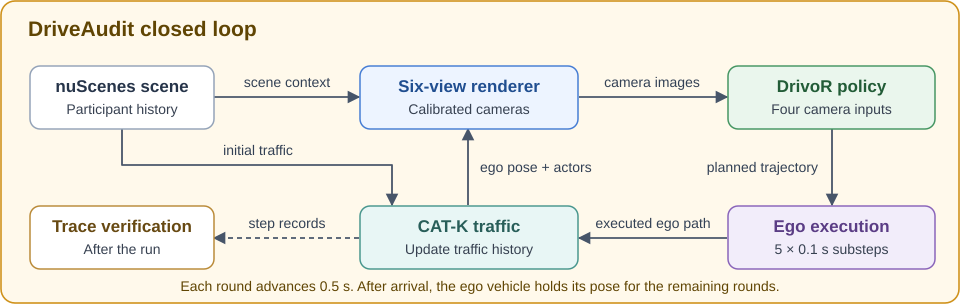

[](README.md) [](README.zh-CN.md)

[Interactive scene comparisons](index.html)

<div align="center" id="top">


## Beyond Visual Realism: Benchmarking Generated Driving Scenarios as Policy Tests

[](https://nova-chen151.github.io/Onsite3DSG-Benchmark.github.io/#leaderboard)
[](#getting-started)
[](#benchmarked-models)
[](#documentation)
[](https://github.com/Nova-chen151/DriveAudit/blob/main/LICENSE)

<a id="overview"></a>
<a id="-overview"></a>


</div>

<a id="highlights"></a>
## 🔥 Highlights

- 📐 **Four-level evaluation:** connect observation quality, scenario fidelity, policy response, and testing effectiveness in one framework.
- ⚖️ **Quality-aware scoring:** QTES rewards paired policy degradation together with retained scenario quality; RPDMS adds responsibility-aware collision scoring.
- 🌐 **Multi-source, multi-model benchmark:** 550 scenarios, seven generation baselines, and six driving policies, with tooling for traffic generation, rendering, paired evaluation, and closed-loop feedback.

<a id="news"></a>
## 📢 News

- `[2026/11/24]` We released the code **v1.0**.

<a id="contents"></a>
## 📌 Table of Contents

- 📐 [Evaluation framework](#evaluation)
- 📦 [Dataset](#dataset)
- ⚖️ [Leaderboard](#leaderboard) · [Benchmarked models](#benchmarked-models)
- 🎯 [Getting started](#getting-started)
  - [Install](#installation)
  - [Prepare resources and configuration](#resources-and-configuration)
  - [Generate driving scenarios](#scenario-generation)
  - [Evaluate the six-policy panel](#six-policy-evaluation)
- 🔁 [Closed-loop testing](#closed-loop)
- 📚 [Documentation](#documentation)
- ❤️ [Acknowledgements](#acknowledgements)
- ⭐ [License and Citation](#license-and-citation)

<a id="evaluation"></a>
## 📐 Evaluation Framework

<table>
<thead><tr><th></th><th>Dimension</th><th>Why we evaluate it</th></tr></thead>
<tbody>
<tr>
<td width="144" align="center"></td>
<td width="170"><b>Observation quality</b></td>
<td>Rendering artifacts and flicker can change how a driving policy responds. We check whether the camera views look realistic and remain coherent over time before interpreting the policy’s behavior.</td>
</tr>
<tr>
<td width="144" align="center"></td>
<td width="170"><b>Scenario fidelity</b></td>
<td>A recorded drive captures only one possible future. We check whether the generated traffic moves plausibly and whether the camera views agree with each other and with the traffic states used to score the policy.</td>
</tr>
<tr>
<td width="144" align="center"></td>
<td width="170"><b>Policy response</b></td>
<td>We run the same frozen policy on recorded and generated observations to see how its plans change in safety, comfort, and route progress. When a collision occurs, we assess how much the ego vehicle contributed to it.</td>
</tr>
<tr>
<td width="144" align="center"></td>
<td width="170"><b>Quality-aware testing effectiveness</b></td>
<td>Poor rendering or implausible traffic can make a policy perform worse. We give a performance drop relative to the paired recording more weight when the generated scene preserves visual quality and traffic fidelity.</td>
</tr>
</tbody>
</table>

The same frozen policy runs on both branches with matched scene identities, timestamps, calibration, and public ego motion. Each branch uses its own traffic for scoring. **Higher RPDMS means better policy performance; higher QTES means greater quality-aware testing effectiveness.**

The main benchmark uses **non-reactive replay**: predicted actions do not change subsequent observations. The separate [closed-loop runner](#closed-loop) feeds executed actions back into generation. See the [evaluation guide](https://github.com/Nova-chen151/DriveAudit/blob/main/docs/evaluation.md) for quality evidence, common-support requirements, and the distinction between single-policy diagnostics and formal six-policy QTES.

<a id="dataset"></a>
## 📦 Dataset

The example uses two nuScenes cases from the participant archive, `case_000001` and `case_000002`. Set `archive` in the [example configuration](https://github.com/Nova-chen151/DriveAudit/blob/main/configs/generation.json) to your copy of the package. Each case provides 10 frames of six-camera history, traffic tracks, a map, and the ego and camera poses for the next 80 frames.

For each case, submit a CSV of future traffic trajectories and 80 RGB images per camera for all six views. Use the two cases to check your pipeline. For the competition submission, generate results for every case on the organizer’s list and check them with the validator in the participant package. [Challenge and submission format](https://github.com/Nova-chen151/DriveAudit/blob/main/docs/challenge.md)

<a id="benchmark-results"></a>
<a id="leaderboard"></a>
## ⚖️ Leaderboard

The [interactive leaderboard](https://nova-chen151.github.io/Onsite3DSG-Benchmark.github.io/#leaderboard) ranks generators by QTES under the **generated trajectories + rendering** setting. Sort the metric columns to see how each model’s visual quality and traffic fidelity compare with its effect on driving policies. Open a model’s score record for its full results.

<a id="model-zoo"></a>
<a id="benchmarked-models"></a>
<details open>
<summary><b>Benchmarked Models</b></summary>

<a id="six-view-rendering-models--source"></a>
<a id="driving-policies--source"></a>

| Rendering models | Driving policies |
| --- | --- |
| [MagicDrive-V2](https://github.com/Nova-chen151/DriveAudit/tree/main/models/generation/image/MagicDrive-V2)&nbsp;·&nbsp;**ICCV&nbsp;2025**&nbsp;·&nbsp;[code](https://github.com/flymin/MagicDrive-V2) | [UniAD](https://github.com/Nova-chen151/DriveAudit/tree/main/models/agents/UniAD)&nbsp;·&nbsp;**CVPR&nbsp;2023**&nbsp;·&nbsp;[code](https://github.com/OpenDriveLab/UniAD) |
| [OpenDWM](https://github.com/Nova-chen151/DriveAudit/tree/main/models/generation/image/OpenDWM)&nbsp;·&nbsp;**Project**&nbsp;·&nbsp;[code](https://github.com/SenseTime-FVG/OpenDWM) | [VAD](https://github.com/Nova-chen151/DriveAudit/tree/main/models/agents/VAD)&nbsp;·&nbsp;**ICCV&nbsp;2023**&nbsp;·&nbsp;[code](https://github.com/hustvl/VAD) |
| [Panacea](https://github.com/Nova-chen151/DriveAudit/tree/main/models/generation/image/Panacea)&nbsp;·&nbsp;**CVPR&nbsp;2024**&nbsp;·&nbsp;[code](https://github.com/wenyuqing/panacea) | [DrivoR](https://github.com/Nova-chen151/DriveAudit/tree/main/models/agents/DrivoR)&nbsp;·&nbsp;**CVPR&nbsp;2026**&nbsp;·&nbsp;[code](https://github.com/valeoai/DrivoR) |
| [DreamForge](https://github.com/Nova-chen151/DriveAudit/tree/main/models/generation/image/DreamForge)&nbsp;·&nbsp;[arXiv&nbsp;2024](https://arxiv.org/abs/2409.04003)&nbsp;·&nbsp;[code](https://github.com/PJLab-ADG/DriveArena) | [SparseDriveV2](https://github.com/Nova-chen151/DriveAudit/tree/main/models/agents/SparseDriveV2)&nbsp;·&nbsp;**ECCV&nbsp;2026**&nbsp;·&nbsp;[code](https://github.com/swc-17/SparseDriveV2) |
| [BaseDreamer](https://github.com/Nova-chen151/DriveAudit/tree/main/models/generation/image/BaseDreamer)&nbsp;·&nbsp;**Adaptation**&nbsp;·&nbsp;[source](https://github.com/Nova-chen151/DriveAudit/blob/main/driveaudit/generation/README.md) | [DiffusionDriveV2](https://github.com/Nova-chen151/DriveAudit/tree/main/models/agents/DiffusionDriveV2)&nbsp;·&nbsp;[arXiv&nbsp;2025](https://arxiv.org/abs/2512.07745)&nbsp;·&nbsp;[code](https://github.com/hustvl/DiffusionDriveV2) |
| [HorizonDrive](https://github.com/Nova-chen151/DriveAudit/tree/main/models/generation/image/HorizonDrive)&nbsp;·&nbsp;[arXiv&nbsp;2026](https://arxiv.org/abs/2605.11596)&nbsp;·&nbsp;[code](https://github.com/zcliangyue/HorizonDrive) | [GoalFlow](https://github.com/Nova-chen151/DriveAudit/tree/main/models/agents/GoalFlow)&nbsp;·&nbsp;**CVPR&nbsp;2025**&nbsp;·&nbsp;[code](https://github.com/YvanYin/GoalFlow) |
| [MagicDrive](https://github.com/Nova-chen151/DriveAudit/tree/main/models/generation/image/MagicDrive)&nbsp;·&nbsp;**ICLR&nbsp;2024**&nbsp;·&nbsp;[code](https://github.com/cure-lab/MagicDrive) | — |

**Traffic-generation backend:** [CAT-K](https://github.com/Nova-chen151/DriveAudit/tree/main/models/generation/trajectory/CAT-K) supplies traffic trajectories and is not one of the seven main rendering baselines. See the [generation guide](https://github.com/Nova-chen151/DriveAudit/blob/main/docs/generation.md) for renderer setup and the [evaluation guide](https://github.com/Nova-chen151/DriveAudit/blob/main/docs/evaluation.md) for policy adapters and the sensor protocol.

</details>

<a id="getting-started"></a>
## 🎯 Getting Started

<a id="installation"></a>
### 1. Clone and install

```bash
git clone https://github.com/Nova-chen151/DriveAudit.git
cd DriveAudit
python -m pip install -e '.[evaluation]'
python -m driveaudit --help
```

The orchestration package requires **Python ≥ 3.9**. Native GPU inference requires Linux and each model's compatible environment. Follow the [generation guide](https://github.com/Nova-chen151/DriveAudit/blob/main/docs/generation.md) to install source adapters, compiled extensions, and external weights; use the [policy guide](https://github.com/Nova-chen151/DriveAudit/blob/main/docs/evaluation.md) for driving-policy environments.

<a id="resources-and-configuration"></a>
### 2. Prepare resources and configuration

The example configuration uses these paths relative to the repository root.

| Path | What goes here |
| --- | --- |
| [work/resources/participant.tar.gz](https://github.com/Nova-chen151/DriveAudit/tree/main/work/resources) | The nuScenes participant archive. The runner extracts the selected scenes. Copy or link the original `.tar.gz` under this name, or set `archive` in [generation.json](https://github.com/Nova-chen151/DriveAudit/blob/main/configs/generation.json) to its existing location. |
| [weights/](https://github.com/Nova-chen151/DriveAudit/tree/main/weights) | The shared model store. Use `catk/` for traffic weights and vocabularies, `renderers/` and `magicdrivev2/` for image generation, `agents/` for driving policies and `evaluation/` for metric weights. |
| `work/resources/envs/` | Model-specific Python environments, or links to the environments on your system. |
| `work/resources/scene_mapping.json` | Organizer-only mapping for paired evaluation, alongside access to the recorded references. Participants can run generation without it. |

| Configuration | Purpose |
| --- | --- |
| [generation.json](https://github.com/Nova-chen151/DriveAudit/blob/main/configs/generation.json) | Participant archive, scenes, CAT-K, renderers, and interpreters |
| [pipeline.json](https://github.com/Nova-chen151/DriveAudit/blob/main/configs/pipeline.json) | Generation, policy selection, organizer resources, and outputs |
| [quality.yaml](https://github.com/Nova-chen151/DriveAudit/blob/main/configs/quality.yaml) | Visual-quality evaluation settings |

JSON paths resolve **relative to the configuration file**. The example selects **OpenDWM + DrivoR**. Adjust Slurm partitions, GPU types, and resource paths for your cluster; use a distinct evaluation output directory for each renderer.

<a id="scenario-generation"></a>
<a id="3-inspect-and-submit-the-pipeline"></a>
### 3. Generate driving scenarios

```bash
# Inspect stage commands before submitting GPU work.
python -m driveaudit run --config configs/pipeline.json --plan

# Submit traffic generation, rendering, and configured evaluation stages.
bash scripts/submit_demo.sh configs/pipeline.json
```

The generation flow is **CAT-K traffic → renderer conditions → six-view RGB**. Participants can stop after rendering and [export a submission](https://github.com/Nova-chen151/DriveAudit/blob/main/docs/generation.md#participant-inputs-and-submission).

<a id="six-policy-evaluation"></a>
### 4. Evaluate the six-policy panel

After generated observations, paired reference inputs, policy assets, and quality measurements are ready:

```bash
bash scripts/submit_panel.sh configs/pipeline.json

# Inspect one policy invocation.
python -m driveaudit panel infer --config configs/pipeline.json \
  --policy goalflow --source generated --plan
```

The panel evaluates each policy on generated and recorded branches. Reports contain paired policy scores, TE, QTES, quality retention, and coverage. See [policies and evaluation](https://github.com/Nova-chen151/DriveAudit/blob/main/docs/evaluation.md) for standalone inference, scoring, and required evidence.

<a id="closed-loop"></a>
## 🔁 Closed-loop Testing

Each round, the driving policy plans from rendered camera images. The renderer then uses the executed ego motion and updated traffic to generate the policy’s next observation.



| Component | Role in the closed loop |
| --- | --- |
| [Scene configuration](https://github.com/Nova-chen151/DriveAudit/blob/main/driveaudit/closed_loop/configure.py) | Matches the participant scene to its rendering inputs and takes the navigation goal from the final public ego position. |
| [Scene renderer](https://github.com/Nova-chen151/DriveAudit/tree/main/models/generation/image) | Renders calibrated camera views from the current ego pose and surrounding traffic. |
| [Driving policy](https://github.com/Nova-chen151/DriveAudit/tree/main/models/agents) | Uses camera images, ego motion, and a navigation command to plan a trajectory. |
| [Ego execution](https://github.com/Nova-chen151/DriveAudit/blob/main/driveaudit/closed_loop/core.py) | Executes the first segment of the planned trajectory and commits the resulting ego pose. |
| [Traffic model](https://github.com/Nova-chen151/DriveAudit/tree/main/models/generation/trajectory) | Advances surrounding actors and writes their predicted motion and the executed ego path into the history for the next round. |
| [Trace verification](https://github.com/Nova-chen151/DriveAudit/blob/main/driveaudit/closed_loop/verify_run.py) | Checks that the next render uses the committed pose and that the images sent to the policy match the saved frames. |

**Example implementation.** In the nuScenes example, [CAT-K](https://github.com/Nova-chen151/DriveAudit/blob/main/models/generation/trajectory/CAT-K/closed_loop.py) advances traffic. The renderer generates six views, and [DrivoR](https://github.com/Nova-chen151/DriveAudit/blob/main/models/agents/DrivoR/driveaudit_adapter.py) uses four of them to plan. The executor applies the first 0.5 s in five 0.1 s steps.

Follow the [closed-loop guide](https://github.com/Nova-chen151/DriveAudit/blob/main/closed_loop/README.md#run) to run and verify a scene. For benchmark scores, see [paired policy evaluation](https://github.com/Nova-chen151/DriveAudit/blob/main/docs/evaluation.md).

<a id="documentation"></a>
## 📚 Documentation

| Task | Guide |
| --- | --- |
| Prepare inputs and weights; generate traffic and RGB; export submissions | [Generation](https://github.com/Nova-chen151/DriveAudit/blob/main/docs/generation.md) |
| Configure policies; run paired inference and QTES evaluation | [Policies and evaluation](https://github.com/Nova-chen151/DriveAudit/blob/main/docs/evaluation.md) |
| Run and verify action-feedback testing | [Closed-loop testing](https://github.com/Nova-chen151/DriveAudit/blob/main/closed_loop/README.md) |

<a id="acknowledgements-and-terms"></a>
<a id="acknowledgements"></a>
## ❤️ Acknowledgements

We thank the [nuScenes team](https://www.nuscenes.org/nuscenes) for the driving data, [CAT-K](https://github.com/NVlabs/catk) for traffic generation, and [NAVSIM](https://github.com/autonomousvision/navsim) for the planning evaluation framework. We also thank the contributors to the [rendering models and driving policies](#benchmarked-models) used in DriveAudit.

<a id="license-and-citation"></a>
## ⭐ License and Citation

Our code is available under the [Apache License 2.0](https://github.com/Nova-chen151/DriveAudit/blob/main/LICENSE). Third-party code and pretrained weightsretain their respective licenses and notices.

The participant example uses nuScenes data. Unless otherwise marked, Motional provides these data under [CC BY-NC-SA 4.0](https://creativecommons.org/licenses/by-nc-sa/4.0/) with its additional [nuScenes Dataset Terms](https://www.nuscenes.org/terms-of-use). Commercial use requires a separate [license from Motional](https://www.nuscenes.org/terms-of-use-commercial).

[↑ Back to top](#top)
