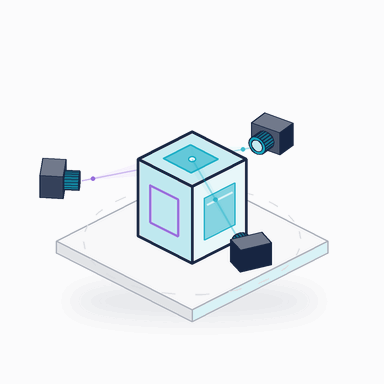
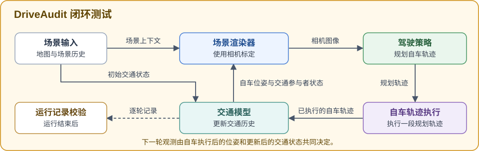

[](README.md) [](README.zh-CN.md)

<div align="center" id="top">


## 超越视觉真实感：面向自动驾驶测试的生成式世界模型挑战赛

[](https://nova-chen151.github.io/Onsite3DSG-Benchmark.github.io/#leaderboard)
[](#getting-started)
[](#benchmarked-models)
[](#documentation)
[](LICENSE)

<a id="overview"></a>
<a id="-项目概览"></a>


</div>

<a id="highlights"></a>
<a id="核心特点"></a>
## 🔥 核心特点

- 📐 **四层评测体系：** 连接观测质量、场景保真、策略响应与测试有效性。
- ⚖️ **质量感知评分：** QTES 将配对策略性能下降与场景质量保持相结合；RPDMS 引入责任感知的碰撞评分。
- 🌐 **多源、多模型基准：** 覆盖 550 个场景、7 个生成基线与 6 个驾驶策略，提供交通生成、渲染、配对评测和闭环反馈工具。

<a id="news"></a>
## 📢 最新动态

- `[2026/11/24]` 我们发布了 **v1.0** 版代码。

<a id="contents"></a>
<a id="目录"></a>
## 📌 目录

- 📐 [评测框架](#evaluation)
- 📦 [数据集](#dataset)
- ⚖️ [排行榜](#leaderboard) · [参评模型](#benchmarked-models)
- 🎯 [快速开始](#getting-started)
  - [安装](#installation)
  - [准备资源与配置](#resources-and-configuration)
  - [生成驾驶场景](#scenario-generation)
  - [六策略面板评测](#six-policy-evaluation)
- 🔁 [闭环测试](#closed-loop)
- 📚 [使用文档](#documentation)
- ❤️ [致谢](#acknowledgements)
- ⭐ [许可证与引用](#license-and-citation)

<a id="evaluation"></a>
## 📐 评测框架

<table>
<thead><tr><th></th><th>维度</th><th>为什么评测这一维度</th></tr></thead>
<tbody>
<tr>
<td width="144" align="center"></td>
<td width="170"><b>观测质量</b></td>
<td>渲染伪影和画面闪烁都可能改变驾驶策略的判断。因此，在解读策略行为之前，我们先检查各相机画面是否逼真、前后帧是否连贯。</td>
</tr>
<tr>
<td width="144" align="center"></td>
<td width="170"><b>场景保真</b></td>
<td>一次路测只记录了一种可能的后续发展。评测生成场景时，我们检查车辆运动是否合理、不同视角下的车辆位置是否一致，以及画面中的运动是否与评分所用的交通状态相符。</td>
</tr>
<tr>
<td width="144" align="center"></td>
<td width="170"><b>策略响应</b></td>
<td>我们让同一个冻结的驾驶策略分别根据实录画面和生成画面规划行驶轨迹，比较两组轨迹的安全性、舒适性和行驶进度。发生碰撞时，我们还评估自车在该次碰撞中承担的责任。</td>
</tr>
<tr>
<td width="144" align="center"></td>
<td width="170"><b>质量感知测试有效性</b></td>
<td>画面失真或交通行为失常也会导致策略表现变差。我们以策略在配对实录场景中的表现为基准。性能下降幅度相同时，生成场景的画面越可靠、交通越可信，这次下降就越能说明测试揭示了策略弱点。</td>
</tr>
</tbody>
</table>

两条分支使用同一个冻结策略，并对齐场景身份、时间戳、标定及公开自车运动，各自使用对应交通状态评分。**RPDMS 越高表示策略表现越好；QTES 越高表示质量感知的测试有效性越高。**

主要基准使用**非反应式回放**：预测动作不会改变后续观测。独立的[闭环运行器](#closed-loop)则将实际执行动作反馈到生成过程。质量证据、共同有效窗口，以及单策略诊断与正式六策略 QTES 的区别，见[评测指南](docs/evaluation.zh-CN.md)。

<a id="dataset"></a>
## 📦 数据集

示例使用选手包中的两个 nuScenes 场景 `case_000001` 和 `case_000002`。将[示例配置](configs/generation.json)中的 `archive` 设为本地选手包路径。每个场景提供六路相机的 10 帧历史图像、历史交通轨迹、地图，以及未来 80 帧的自车和相机位姿。

每个场景需提交一份未来交通轨迹 CSV，以及六路相机各 80 张 RGB 图像。可以先用这两个场景跑通生成和校验流程。正式提交时，需为主办方清单中的每个场景生成结果，并用选手包自带的校验器检查。[赛题与提交格式](docs/challenge.zh-CN.md)

<a id="benchmark-results"></a>
<a id="leaderboard"></a>
## ⚖️ 排行榜

[在线排行榜](https://nova-chen151.github.io/Onsite3DSG-Benchmark.github.io/#leaderboard)按 QTES 对**生成轨迹 + 渲染**设置下的模型排名。点击指标列可重新排序，对照各模型的画面质量、交通保真度与驾驶策略表现。点击模型所在行的“成绩记录”可查看该模型的完整结果。

<a id="model-zoo"></a>
<a id="benchmarked-models"></a>
<details open>
<summary><b>已评测模型</b></summary>

<a id="六视角渲染模型--源码"></a>
<a id="驾驶策略--源码"></a>

| 渲染模型 | 驾驶策略 |
| --- | --- |
| [MagicDrive-V2](models/generation/image/MagicDrive-V2)&nbsp;·&nbsp;**ICCV&nbsp;2025**&nbsp;·&nbsp;[源码](https://github.com/flymin/MagicDrive-V2) | [UniAD](models/agents/UniAD)&nbsp;·&nbsp;**CVPR&nbsp;2023**&nbsp;·&nbsp;[源码](https://github.com/OpenDriveLab/UniAD) |
| [OpenDWM](models/generation/image/OpenDWM)&nbsp;·&nbsp;**软件项目**&nbsp;·&nbsp;[源码](https://github.com/SenseTime-FVG/OpenDWM) | [VAD](models/agents/VAD)&nbsp;·&nbsp;**ICCV&nbsp;2023**&nbsp;·&nbsp;[源码](https://github.com/hustvl/VAD) |
| [Panacea](models/generation/image/Panacea)&nbsp;·&nbsp;**CVPR&nbsp;2024**&nbsp;·&nbsp;[源码](https://github.com/wenyuqing/panacea) | [DrivoR](models/agents/DrivoR)&nbsp;·&nbsp;**CVPR&nbsp;2026**&nbsp;·&nbsp;[源码](https://github.com/valeoai/DrivoR) |
| [DreamForge](models/generation/image/DreamForge)&nbsp;·&nbsp;[arXiv&nbsp;2024](https://arxiv.org/abs/2409.04003)&nbsp;·&nbsp;[源码](https://github.com/PJLab-ADG/DriveArena) | [SparseDriveV2](models/agents/SparseDriveV2)&nbsp;·&nbsp;**ECCV&nbsp;2026**&nbsp;·&nbsp;[源码](https://github.com/swc-17/SparseDriveV2) |
| [BaseDreamer](models/generation/image/BaseDreamer)&nbsp;·&nbsp;**项目适配**&nbsp;·&nbsp;[来源（英文）](driveaudit/generation/README.md) | [DiffusionDriveV2](models/agents/DiffusionDriveV2)&nbsp;·&nbsp;[arXiv&nbsp;2025](https://arxiv.org/abs/2512.07745)&nbsp;·&nbsp;[源码](https://github.com/hustvl/DiffusionDriveV2) |
| [HorizonDrive](models/generation/image/HorizonDrive)&nbsp;·&nbsp;[arXiv&nbsp;2026](https://arxiv.org/abs/2605.11596)&nbsp;·&nbsp;[源码](https://github.com/zcliangyue/HorizonDrive) | [GoalFlow](models/agents/GoalFlow)&nbsp;·&nbsp;**CVPR&nbsp;2025**&nbsp;·&nbsp;[源码](https://github.com/YvanYin/GoalFlow) |
| [MagicDrive](models/generation/image/MagicDrive)&nbsp;·&nbsp;**ICLR&nbsp;2024**&nbsp;·&nbsp;[源码](https://github.com/cure-lab/MagicDrive) | — |

arXiv 表示预印本；OpenDWM 为多论文实现项目，BaseDreamer 为[选手快照](driveaudit/generation/bundles/native-sources.tar.json)中的适配基线。

**交通生成后端：**[CAT-K](models/generation/trajectory/CAT-K) 提供交通轨迹，不计入上述七个主渲染基线。渲染器配置见[生成指南](docs/generation.zh-CN.md)，策略适配与传感器协议见[评测指南](docs/evaluation.zh-CN.md)。

</details>

<a id="getting-started"></a>
## 🎯 快速开始

<a id="installation"></a>
### 1. 克隆与安装

```bash
git clone https://github.com/Nova-chen151/DriveAudit.git
cd DriveAudit
python -m pip install -e '.[evaluation]'
python -m driveaudit --help
```

流程编排包要求 **Python ≥ 3.9**，原生 GPU 推理需要 Linux 及各模型匹配的环境。按[生成指南](docs/generation.zh-CN.md)安装源码适配、编译扩展和外部权重；驾驶策略环境见[策略指南](docs/evaluation.zh-CN.md)。

<a id="resources-and-configuration"></a>
### 2. 准备资源与配置

示例配置使用以下路径，均从仓库根目录算起。

| 路径 | 放什么 |
| --- | --- |
| [work/resources/participant.tar.gz](work/resources/README.zh-CN.md) | **选手输入包**。把下载的 nuScenes 原始 `.tar.gz` 复制或软链接为这个文件名，程序会自行解包。也可以在 [generation.json](configs/generation.json) 中把 `archive` 指向原文件。 |
| [weights/](weights/README.zh-CN.md) | **共享权重库**。`catk/` 放交通模型权重与词表，`renderers/`、`magicdrivev2/` 放渲染权重，`agents/` 放主车权重，`evaluation/` 放评价模型权重。 |
| `work/resources/envs/` | 各模型使用的 Python 环境，可软链接到本机已有环境。 |
| `work/resources/scene_mapping.json` | 主办方配对评分使用的场景映射，配合真实参考数据使用。选手运行生成阶段无需准备此文件。 |

| 配置 | 用途 |
| --- | --- |
| [generation.json](configs/generation.json) | 选手包、场景、CAT-K、渲染器和解释器 |
| [pipeline.json](configs/pipeline.json) | 生成、策略选择、主办方资源与输出 |
| [quality.yaml](configs/quality.yaml) | 视觉质量评测设置 |

JSON 路径**相对于配置文件解析**。示例选择 **OpenDWM + DrivoR**。请按集群调整 Slurm 分区、GPU 类型和资源路径，并为不同渲染器使用独立的评测输出目录。

<a id="scenario-generation"></a>
<a id="3-检查并提交完整流程"></a>
### 3. 生成驾驶场景

```bash
# 提交 GPU 作业前，先检查各阶段命令。
python -m driveaudit run --config configs/pipeline.json --plan

# 提交交通生成、图像渲染及已配置的评测阶段。
bash scripts/submit_demo.sh configs/pipeline.json
```

生成流程为 **CAT-K 交通轨迹 → 渲染条件 → 六视角 RGB**。选手可在渲染后停止并[导出提交](docs/generation.zh-CN.md#participant-inputs-and-submission)。

<a id="six-policy-evaluation"></a>
### 4. 运行六策略面板评测

生成观测、配对参考输入、策略权重与质量测量准备完毕后，运行：

```bash
bash scripts/submit_panel.sh configs/pipeline.json

# 检查单个策略的调用命令。
python -m driveaudit panel infer --config configs/pipeline.json \
  --policy goalflow --source generated --plan
```

面板在生成与真实分支上运行各策略，报告配对策略得分、TE、QTES、质量保持率和覆盖率。独立推理、评分及必要证据见[策略与评测](docs/evaluation.zh-CN.md)。

<a id="closed-loop"></a>
## 🔁 闭环测试

每一轮，驾驶策略根据渲染图像规划轨迹。执行器推进自车，交通模型更新周围车辆的状态，渲染器据此生成策略下一轮看到的画面。



| 组件 | 在闭环中的作用 |
| --- | --- |
| [场景配置](driveaudit/closed_loop/configure.py) | 将选手场景与对应的渲染输入配对，并以公开自车轨迹的终点作为导航目标。 |
| [场景渲染器](models/generation/image) | 根据当前自车位姿、周围交通状态和相机标定生成图像。 |
| [驾驶策略](models/agents) | 根据相机图像、自车运动状态和导航指令规划轨迹。 |
| [自车轨迹执行](driveaudit/closed_loop/core.py) | 执行规划轨迹的第一段，并记录执行后的自车位姿。 |
| [交通模型](models/generation/trajectory) | 推演周围交通参与者的运动，将预测轨迹与自车实际执行的轨迹一同写入历史，供下一轮使用。 |
| [运行记录校验](driveaudit/closed_loop/verify_run.py) | 核对下一轮渲染使用的位姿与上轮执行结果是否一致，并检查策略收到的图像是否与保存的渲染帧相符。 |

**示例实现**　在 nuScenes 示例中，[CAT-K](models/generation/trajectory/CAT-K/closed_loop.py) 推演交通状态。渲染器生成六路图像，[DrivoR](models/agents/DrivoR/driveaudit_adapter.py) 使用其中四路规划轨迹。执行器以 0.1 秒为一步，执行规划的前 0.5 秒。

运行和校验单个场景的步骤见[闭环指南](closed_loop/README.zh-CN.md#run)。基准分数的计算方式见[配对策略评测](docs/evaluation.zh-CN.md)。

<a id="documentation"></a>
## 📚 使用文档

| 任务 | 指南 |
| --- | --- |
| 准备输入和权重、生成交通与图像、导出提交 | [场景生成](docs/generation.zh-CN.md) |
| 配置策略、执行配对推理与 QTES 评测 | [策略与评测](docs/evaluation.zh-CN.md) |
| 运行并验证动作反馈测试 | [闭环测试](closed_loop/README.zh-CN.md) |

<a id="acknowledgements-and-terms"></a>
<a id="acknowledgements"></a>
## ❤️ 致谢

感谢 [nuScenes 团队](https://www.nuscenes.org/nuscenes)提供驾驶数据，感谢 [CAT-K](https://github.com/NVlabs/catk) 和 [NAVSIM](https://github.com/autonomousvision/navsim) 的贡献者提供交通生成模型和规划评测框架。也感谢 DriveAudit 使用的[渲染模型与驾驶策略](#benchmarked-models)的各位贡献者。

<a id="license-and-citation"></a>
## ⭐ 许可证与引用

DriveAudit 的代码采用 [Apache License 2.0](LICENSE)。第三方代码和预训练权重沿用各自的许可与声明。

选手示例使用 nuScenes 数据。除另有标注外，Motional 按照 [CC BY-NC-SA 4.0（署名—非商业性使用—相同方式共享）](https://creativecommons.org/licenses/by-nc-sa/4.0/deed.zh-hans)及其附加的 [nuScenes 数据集使用条款](https://www.nuscenes.org/terms-of-use)提供这些数据。商业使用须另行取得 [Motional 的商业许可](https://www.nuscenes.org/terms-of-use-commercial)。


[↑ 返回顶部](#top)
