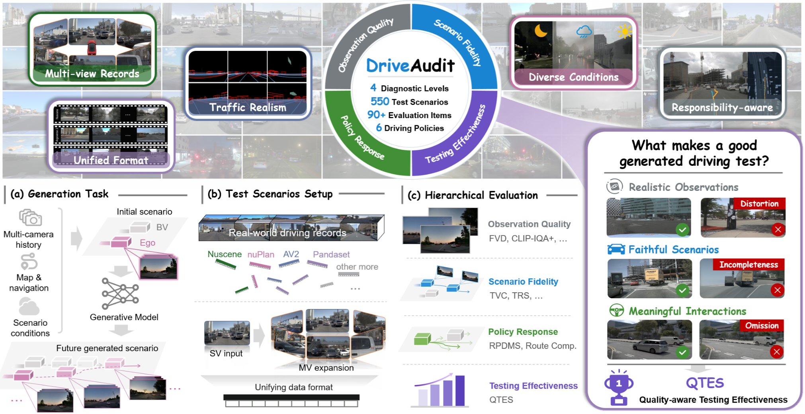

[](README.md) [](README.zh-CN.md)

<div align="center" id="top">


## 超越视觉真实感：评测生成驾驶场景作为策略测试的价值

**生成的驾驶场景只是看起来真实，还是能成为可信的策略测试？**

[](#dataset)
[](#benchmarked-models)
[](#benchmarked-models)
[](#closed-loop)
[](#leaderboard)

[项目概览](#overview) · [评测框架](#evaluation) · [排行榜](#leaderboard) · [快速开始](#getting-started) · [使用文档](#documentation)



</div>

<a id="overview"></a>
## 🔎 项目概览

逼真的驾驶视频不一定是可靠的策略测试：生成图像可能与交通状态不一致，受损观测也可能让策略失败，却无法揭示有意义的驾驶能力缺陷。**DriveAudit 评估生成驾驶场景的测试价值，而不孤立地追求视觉真实感或策略失败。**

流程将**交通轨迹生成**与**多视角渲染**解耦，再使用独立驾驶策略对生成观测与真实观测进行配对评测。通过对比“固定真实轨迹后渲染”与“生成轨迹后渲染”，区分渲染变化与不同交通未来的影响。

### 核心特点

- **四层评测体系：**连接观测质量、场景保真、策略响应与测试有效性。
- **质量感知评分：**QTES 将配对策略性能下降与场景质量保持相结合；RPDMS 引入责任感知的碰撞评分。
- **多源、多模型基准：**覆盖 550 个场景、7 个生成基线与 6 个驾驶策略，提供交通生成、渲染、配对评测和闭环反馈工具。

### 目录

- [评测框架](#evaluation)
- [数据集](#dataset)
- [排行榜与参评模型](#leaderboard)
- [快速开始](#getting-started)
- [闭环测试](#closed-loop)
- [使用文档](#documentation)

<a id="evaluation"></a>
## 📐 评测框架

<table>
<thead><tr><th></th><th>维度</th><th>说明</th></tr></thead>
<tbody>
<tr>
<td width="144" align="center"></td>
<td width="170"><b>观测质量</b></td>
<td><p><b>FVD ↓ · CLIP-IQA+ ↑ · DINO-T ↑</b></p><p>FVD 与 CLIP-IQA+ 评估视觉真实感和感知质量，DINO-T 衡量时间连贯性。这些指标先检查生成观测是否可信、稳定，再为策略行为的解读提供基础。</p></td>
</tr>
<tr>
<td width="144" align="center"></td>
<td width="170"><b>场景保真</b></td>
<td><p><b>Epi@3 ↑ · TVC ↑ · TRS ↑</b></p><p>Epi@3 衡量跨视角几何一致性，TVC 检查渲染图像与交通状态是否一致。TRS 评估交通分布，并额外惩罚几何重叠；合理的替代未来不必复现真实记录中的未来。</p></td>
</tr>
<tr>
<td width="144" align="center"></td>
<td width="170"><b>策略响应</b></td>
<td><p><b>RPDMS ↑ · 路线完成率 ↑</b></p><p>使用独立、冻结的驾驶策略，评估安全、舒适、行驶进度与路线完成情况。RPDMS 根据自车责任修正碰撞评分，路线完成率则衡量策略完成了多少路线。</p></td>
</tr>
<tr>
<td width="144" align="center"></td>
<td width="170"><b>质量感知测试有效性</b></td>
<td><p><b>QTES ↑</b></p><p>QTES 以观测质量和场景保真的保持情况，对配对策略性能退化施加乘性约束。有效的参考自比较得分为 50：并非策略失败越多测试越好，尤其不能把质量恶化导致的失败当作测试价值。</p></td>
</tr>
</tbody>
</table>

两条分支使用同一个冻结策略，并对齐场景身份、时间戳、标定及公开自车运动，各自使用对应交通状态评分。**RPDMS 越高表示策略表现越好；QTES 越高表示质量感知的测试有效性越高。**

主要基准使用**非反应式回放**：预测动作不会改变后续观测。独立的[闭环运行器](#closed-loop)则将实际执行动作反馈到生成过程。质量证据、共同有效窗口，以及单策略诊断与正式六策略 QTES 的区别，见[评测指南](docs/evaluation.zh-CN.md)。

<a id="dataset"></a>
## 📦 数据集

论文基准包含来自**五个数据源的 550 段场景历史**，通过六视角接口保留时间戳、标定和交通状态。

| 输入类型 | 数据源 | 场景数 | 视角来源 |
| --- | --- | ---: | --- |
| 原生多相机 | nuScenes、Argoverse 2、nuPlan、PandaSet | 500 | 真实多相机历史观测 |
| 单目扩展多视角 | Nexar | 50 | 真实前视图，其余五个视角通过生成补全 |

仓库可运行示例选用**两个 nuScenes 场景**：`case_000001` 和 `case_000002`，每个场景生成 **80 帧未来 × 6 路相机**。历史为第 0–9 帧，生成目标为第 10–89 帧，以公开自车和相机位姿为条件；真实观测与合成视角保持区分。

选手输入包、模型权重和主办方参考资源需另行配置。输入包格式和导出步骤见[输入准备与提交](docs/generation.zh-CN.md#participant-inputs-and-submission)。

<a id="benchmark-results"></a>
<a id="leaderboard"></a>
## ⚖️ 排行榜

<p align="center">
<a href="https://nova-chen151.github.io/Onsite3DSG-Benchmark.github.io/"></a>
</p>

通过上方入口访问排行榜网站。本 README 介绍评测维度与参评模型，不重复列出数值结果。

<a id="model-zoo"></a>
<a id="benchmarked-models"></a>
<details open>
<summary><b>已评测模型</b></summary>

### 六视角渲染模型 · 源码

- [x] [MagicDrive-V2](models/generation/image/MagicDrive-V2)
- [x] [OpenDWM](models/generation/image/OpenDWM)
- [x] [Panacea](models/generation/image/Panacea)
- [x] [DreamForge](models/generation/image/DreamForge)
- [x] [BaseDreamer](models/generation/image/BaseDreamer)
- [x] [HorizonDrive](models/generation/image/HorizonDrive)
- [x] [MagicDrive](models/generation/image/MagicDrive)

### 驾驶策略 · 源码

- [x] [UniAD](models/agents/UniAD)
- [x] [VAD](models/agents/VAD)
- [x] [DrivoR](models/agents/DrivoR)
- [x] [SparseDriveV2](models/agents/SparseDriveV2)
- [x] [DiffusionDriveV2](models/agents/DiffusionDriveV2)
- [x] [GoalFlow](models/agents/GoalFlow)

**交通生成后端：**[CAT-K](models/generation/trajectory/CAT-K) 提供交通轨迹，不计入上述七个主渲染基线。渲染器配置见[生成指南](docs/generation.zh-CN.md)，策略适配与传感器协议见[评测指南](docs/evaluation.zh-CN.md)。

仓库包含原生模型源码。检查点及各模型兼容的 Python/CUDA 环境需另行准备；流程编排包不能替代上游运行依赖。

</details>

<a id="getting-started"></a>
## 🎯 快速开始

### 1. 克隆与安装

```bash
git clone https://github.com/Nova-chen151/DriveAudit.git
cd DriveAudit
python -m pip install -e '.[evaluation]'
python -m driveaudit --help
```

流程编排包要求 **Python ≥ 3.9**，原生 GPU 推理需要 Linux 及各模型匹配的环境。按[生成指南](docs/generation.zh-CN.md)安装源码适配、编译扩展和外部权重；驾驶策略环境见[策略指南](docs/evaluation.zh-CN.md)。

### 2. 准备资源与配置

准备选手输入包、原生运行环境和检查点。配对评测还需主办方场景映射及真实参考资源。本地资源可放在 Git 忽略的 `work/`、`weights/` 下，或通过配置指向外部存储。

| 配置 | 用途 |
| --- | --- |
| [generation.json](configs/generation.json) | 选手包、场景、CAT-K、渲染器和解释器 |
| [pipeline.json](configs/pipeline.json) | 生成、策略选择、主办方资源与输出 |
| [quality.yaml](configs/quality.yaml) | 视觉质量评测设置 |

JSON 路径**相对于配置文件解析**。示例选择 **OpenDWM + DrivoR**。请按集群调整 Slurm 分区、GPU 类型和资源路径，并为不同渲染器使用独立的评测输出目录。

### 3. 检查并提交完整流程

```bash
# 提交 GPU 作业前，先检查各阶段命令。
python -m driveaudit run --config configs/pipeline.json --plan

# 提交交通生成、图像渲染及已配置的评测阶段。
bash scripts/submit_demo.sh configs/pipeline.json
```

生成流程为 **CAT-K 交通轨迹 → 渲染条件 → 六视角 RGB**。选手可在渲染后停止并[导出提交](docs/generation.zh-CN.md#participant-inputs-and-submission)；真实参考准备和配对评分需主办方资源。

### 4. 运行六策略面板评测

生成观测、配对参考输入、策略权重与质量测量准备完毕后，运行：

```bash
bash scripts/submit_panel.sh configs/pipeline.json

# 检查单个策略的调用命令。
python -m driveaudit panel infer --config configs/pipeline.json \
  --policy goalflow --source generated --plan
```

面板在生成与真实分支上运行各策略，报告配对策略得分、TE、QTES、质量保持率和覆盖率。独立推理、评分及必要证据见[策略与评测](docs/evaluation.zh-CN.md)。

<a id="closed-loop"></a>
## 🔁 闭环测试

闭环运行器连接 **CAT-K → 六视角渲染 → DrivoR → 自车执行 → 更新交通历史**。每轮将预测轨迹的前 0.5 秒分成五个 0.1 秒子步执行，再根据更新后的状态生成观测。

按[闭环指南](closed_loop/README.zh-CN.md)配置场景、选择渲染器、运行 GPU 推理并验证反馈链路。该验证检查执行与观测的一致性，而非复现完整基准评分。

<a id="documentation"></a>
## 📚 使用文档

| 任务 | 指南 |
| --- | --- |
| 准备输入和权重、生成交通与图像、导出提交 | [场景生成](docs/generation.zh-CN.md) |
| 配置策略、执行配对推理与 QTES 评测 | [策略与评测](docs/evaluation.zh-CN.md) |
| 运行并验证动作反馈测试 | [闭环测试](closed_loop/README.zh-CN.md) |

## 🤝 致谢与使用条款

DriveAudit 基于 [NAVSIM](https://github.com/autonomousvision/navsim) 及[参评模型](#benchmarked-models)列出的交通生成、图像渲染与驾驶策略项目构建。

概览图来自所提供的 DriveAudit 论文《超越视觉真实感：评测生成驾驶场景作为策略测试的价值》。评测动图与定制字标为原创，分别由 [render_framework.py](assets/readme/render_framework.py) 和 [render_title.py](assets/readme/render_title.py) 绘制。论文图保留原有权利。

上游代码保留各自的许可证与声明。数据集、预训练权重及衍生数据仍受各自的使用和再分发条款约束。

[↑ 返回顶部](#top)
